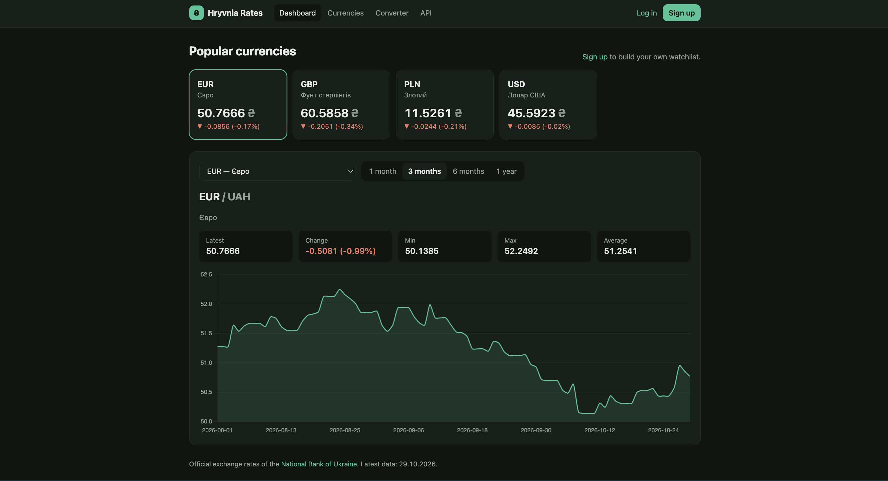

# Hryvnia Rates: NBU exchange-rate dashboard

[](https://github.com/holub-andrii1/currency-dashboard/actions/workflows/ci.yml)

A Django web app that downloads the official exchange rates of the
**National Bank of Ukraine** and turns them into an interactive dashboard,
a currency converter and a REST API.

<!-- After running the app locally with real data, take a screenshot and save it as docs/screenshot.png -->


## Features

- **Dashboard**: watchlist cards with the latest rate and daily change, plus an interactive
  chart (1 month to 1 year) with min / max / average and the change over the period.
- **All currencies**: searchable table of every currency the NBU publishes.
- **Personal watchlist**: sign up, star currencies, and the dashboard shows your favourites.
- **Converter**: convert between any two currencies (cross rates via UAH), on any past date.
- **REST API** (Django REST Framework): currencies, rate history, statistics, conversion.
- **Data import**: `fetch_rates` management command with parallel downloads; it skips days that
  are already stored, so it is safe to run daily from cron.
- Light and dark theme, responsive layout.

## Tech stack

Python 3.12 · Django 5.2 · Django REST Framework · PostgreSQL / SQLite · Chart.js ·
pytest · Ruff · Docker · GitHub Actions

## Quick start (local, SQLite)

```bash
git clone https://github.com/holub-andrii1/currency-dashboard.git
cd currency-dashboard
python -m venv .venv
source .venv/bin/activate        # Windows: .venv\Scripts\activate
pip install -r requirements-dev.txt

python manage.py migrate
python manage.py fetch_rates     # loads the last 365 days from the NBU API
python manage.py runserver
```

Open http://127.0.0.1:8000. Create an admin user with `python manage.py createsuperuser`.

## Run with Docker (PostgreSQL)

```bash
cp .env.example .env             # then change DJANGO_SECRET_KEY
docker compose up --build -d
docker compose exec web python manage.py fetch_rates
```

## Loading data

```bash
python manage.py fetch_rates                                   # last 365 days
python manage.py fetch_rates --days 30                         # last 30 days
python manage.py fetch_rates --start 2025-01-01 --end 2025-12-31
python manage.py fetch_rates --force                           # re-download stored days
```

To keep the data fresh, schedule it once a day, e.g. with cron:

```
0 16 * * * cd /path/to/currency-dashboard && .venv/bin/python manage.py fetch_rates --days 7
```

## REST API

| Endpoint | Description |
|---|---|
| `GET /api/currencies/` | All currencies with the latest rate |
| `GET /api/currencies/{code}/` | One currency |
| `GET /api/currencies/{code}/rates/?start=YYYY-MM-DD&end=YYYY-MM-DD` | Daily rates (default: last 30 days) |
| `GET /api/currencies/{code}/stats/?days=90` | Change, min, max and average over a period |
| `GET /api/convert/?amount=100&from=USD&to=EUR&date=YYYY-MM-DD` | Convert an amount (`date` optional) |

Example:

```bash
curl "http://127.0.0.1:8000/api/convert/?amount=100&from=USD&to=EUR"
```
```json
{"amount": "100.00", "from": "USD", "to": "EUR", "rate": "0.871234", "result": "87.12", "date": "2026-10-27"}
```

## Tests and linting

```bash
pytest                       # 42 tests; the NBU API is mocked, no network needed
ruff check . && ruff format --check .
```

CI runs linting, a migration check and the test suite on every push.

## Project structure

```
config/                 settings, root URLs
rates/
  models.py             Currency, ExchangeRate
  services/nbu.py       NBU API client, parsing, parallel sync with upsert
  services/analytics.py rate series, statistics, conversion
  views.py, forms.py    dashboard, currency list, converter, watchlist
  api.py                DRF serializers and views
  management/commands/fetch_rates.py
accounts/               sign up / log in / log out
templates/, static/     HTML, CSS, Chart.js setup
tests/                  pytest suite
```

## Design notes

- **Business logic lives in `services/`**, not in views, so it is reused by HTML views, the API
  and the management command, and is easy to unit-test.
- **Money uses `Decimal`**, never `float`. NBU values are converted with `Decimal(str(value))`
  to avoid binary floating-point noise.
- **Idempotent import**: a unique constraint on `(currency, date)` and `bulk_create(update_conflicts=True)`
  make repeated imports safe; already stored days are skipped.
- **Parallel downloads**: the NBU API returns one day per request, so downloads run in a thread
  pool while database writes stay in the main thread.
- **No N+1 queries**: the API annotates the latest rate with a subquery, and daily changes load
  two dates for all currencies in a single query.
- **Missing days**: conversion on a date without data uses the closest earlier rate.

## Possible improvements

- Scheduled import with Celery Beat instead of cron
- Compare several currencies on one chart (normalised to % change)
- Caching of chart data, API documentation with OpenAPI / Swagger
- Email or Telegram alerts when a rate crosses a threshold

## Data source

Official exchange rates: [National Bank of Ukraine open data API](https://bank.gov.ua/ua/open-data/api-dev).

## Author

Andrii Holub · [GitHub](https://github.com/holub-andrii1)

Licensed under the MIT License.
